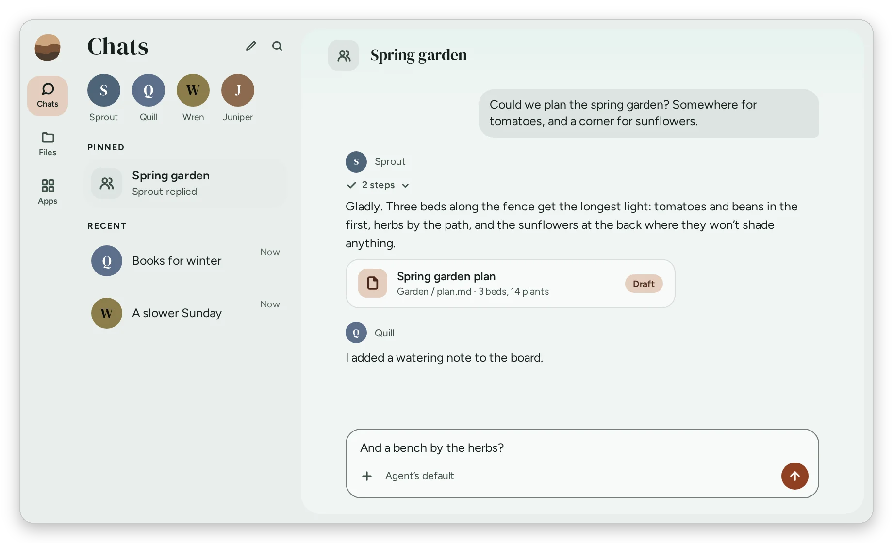
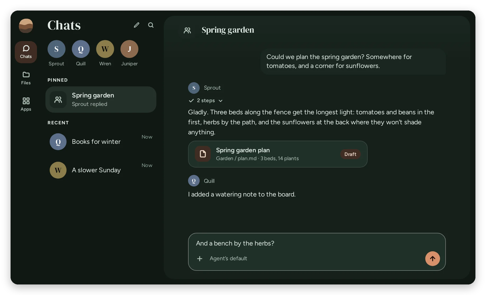

# Mist Trail

<!-- loam:hero -->
**Waterfall spray, fir shade and cedar bark: a cool, fresh Loam that feels like a morning walk.**
<!-- /loam:hero -->

A theme for [Loam](https://github.com/loamhq/loam). Mist Trail is drawn from waterfall spray, fir shade and cedar trunks along a forest trail. By day it is morning fog and dew; by night, wet stone and a glacier-blue pool.

<!-- loam:gallery -->



<!-- /loam:gallery -->

## What changes

- **Every colour, in light and in dark.** Pages, cards, buttons and text,
  each tuned for both, with text kept easy to read. It follows your light and
  dark setting, sunrise and sunset included.
- **Headings in DM Serif Display**, the theme's own display face.
- **Agent faces your way.** Signature faces drawn for this theme (smooth creek stones),
  each agent its own shape, circles, or rounded squares; with a mark or the
  agent's initials inside a Signature face.
- **Its palette:** Morning fog, Dew, Fir shade, Cedar, Tarn, Sandstone by day; Night trail, Wet stone, Mist, Sunlit cedar, Glacier pool, Peat by night.

## Safe to try

In the Market, **Try it first** dresses your Loam in Mist Trail and changes
nothing until you press **Use**. A theme is colours, a font and pictures: it
cannot run code, reach the internet or read your conversations.

## Getting it

In your Loam, open **Settings › Market**, find Mist Trail, and press **Get**
(or **Try it first**). Then choose it in **Settings › Appearance**, where its
options are too.

---

## Technical details

- **What it touches:** nothing but how Loam looks. Its `PLUGIN.md` declares no
  network host, no conversation records, no memory and no server code.
- **What is in it:** `theme.css` (token values only, light and dark, which
  Loam checks before wearing it), `fonts.css` and the DM Serif Display font files,
  its covers, and `assets/`, the two pictures above.
- **Options:** `agent-shapes` (signature, distinct, circle, rounded-square)
  and `face-content` (mark, initials); the defaults are in `PLUGIN.md`.
- **The palette** in `PLUGIN.md` names six of its tokens for the Market's
  preview; the colours themselves are only in `theme.css`.
- **Install from a link** in Settings › Plugins:

  ```
  https://github.com/michaelhejazi/loam-mist-trail/tree/v1.0.3
  ```

## Made by

Michael Hejazi. The theme is under the AGPL-3.0 ([LICENSE](LICENSE)), as
Loam is; its display font, DM Serif Display, is under the SIL Open Font License
([OFL.txt](OFL.txt)).
